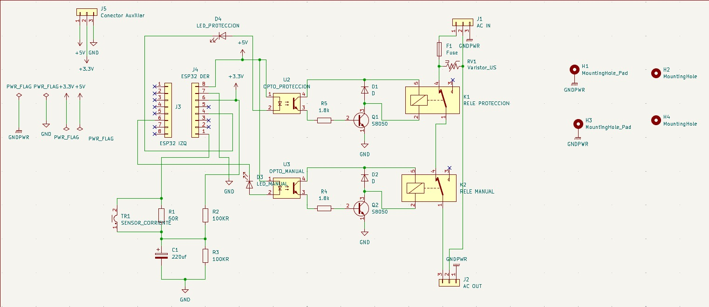
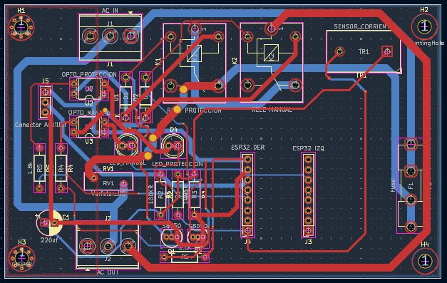
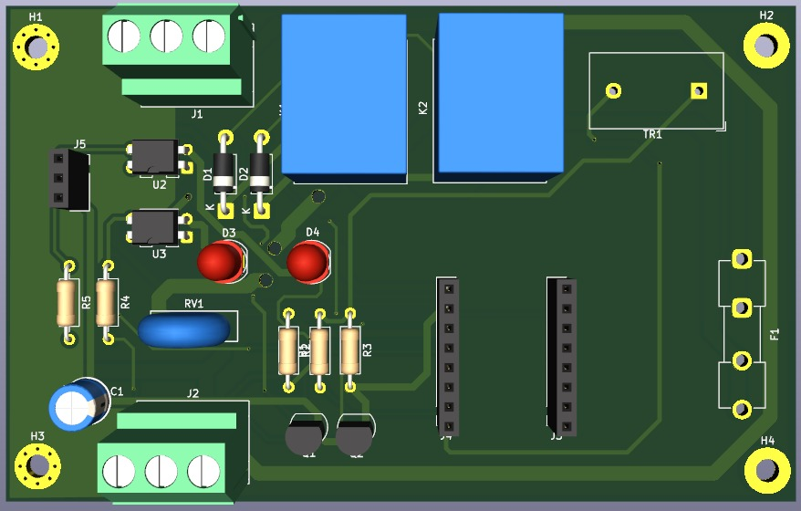
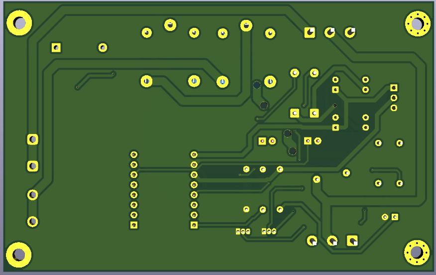

# ECO · Eco Energy Controller Optimizer

Prototipo de monitoreo de consumo energético. Institución Universitaria de Envigado · Ingeniería Electrónica.

## Encuesta

### [Ver la encuesta funcionando](https://santimujim.github.io/Proyecto-ECO/)

Vista de demostración: no permite responder ni enviar. [Ver el código](index.html)

## Documentos

- [Fase I: Planificación técnica](FaseI_PlanificacionTecnica.pdf)
- [Fase II: Prototipo y pruebas](FaseII_PrototipoyPruebas.pdf)
- [Fase III: Piloto en entorno real](FaseIII_PilotoEntornoReal.pdf)

## Diseño electrónico

### Esquemático

### Pistas de la PCB

### Vista 3D frontal

### Vista posterior

## Equipo

Juan Sebastián Camargo Bernal · Johan David Martínez Flórez · Santiago Muñoz Jiménez

**Docente:** Gabriel Jaime Sánchez Zuluaga
